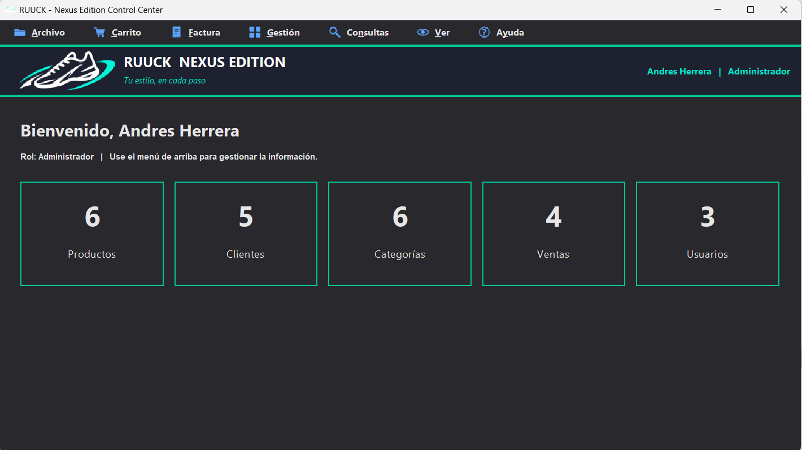
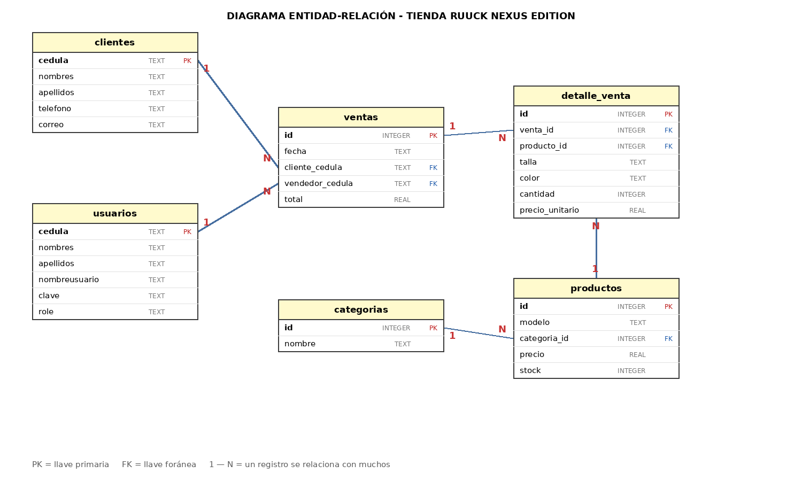

# RUUCK - Nexus Edition (Tienda Deportiva)

**Proyecto del Taller de Panel Administrativo**
Tecnología de Desarrollos de Sistemas Informáticos
📅 II Semestre 2026
👨‍🏫 Profesor: Mag. Carlos Adolfo Beltrán Castro
👨‍💻 Estudiantes:

* [Nombre del estudiante 1] — Cédula: [__________]
* [Nombre del estudiante 2] — Cédula: [__________]

*Imagen de Pantalla Inicial con Menú del Proyecto*

## 🚀 Descripción del Proyecto

Este proyecto simula un sistema de facturación para una tienda de zapatos deportivos (marca **RUUCK**), hecho con **Java SE y Swing**, con base de datos **SQLite**.
Incluye inicio de sesión con roles, navegación mediante una barra de menú, el CRUD de **Productos, Clientes, Categorías y Usuarios**, consultas con JOIN y el registro de ventas con su factura (que descuenta el stock automáticamente).

## 📂 Estructura del Proyecto

* **Logo de la marca** en el inicio de sesión, en el encabezado de la ventana y como icono de las ventanas (`src/main/resources/imagenes/`).
* **Inicio de sesión** con roles *Administrador* y *Vendedor* (tabla `usuarios`).
* **Barra de menú** con opciones, atajos de teclado e iconos:
  * **Archivo:** Inicio, Nueva compra, Guardar factura (.txt), Cerrar sesión, Salir.
  * **Carrito:** Añadir modelo, Cambiar unidades, Quitar seleccionado, Vaciar carrito.
  * **Factura:** Emitir factura (guarda la venta en la base de datos), Limpiar pantalla.
  * **Gestión (CRUD):** Productos, Clientes, Categorías y Usuarios (solo administrador).
  * **Consultas:** Historial de ventas, Detalle de ventas, Productos más vendidos, Inventario por categoría.
  * **Ver:** Catálogo de precios, Modo oscuro.
  * **Ayuda:** ¿Cómo usar?, Acerca de.
* **Pantalla de venta:** elige cliente, modelo, talla, color y cantidad; valida el stock y genera la factura.
* **CRUD** con tabla, búsqueda, formulario y botones Nuevo / Guardar / Actualizar / Eliminar.

### Permisos por rol

| Rol | Permisos |
|---|---|
| Administrador | Todo, incluida la gestión de usuarios, productos y categorías |
| Vendedor | Realizar ventas, gestionar clientes y consultar (productos y categorías en solo lectura) |

## 🗄️ Base de datos

Archivo `tienda.db` (SQLite). El script de creación y los datos de ejemplo están en [`docs/tienda_script.sql`](docs/tienda_script.sql).

| Tabla | Descripción |
|---|---|
| `usuarios` | Personas que inician sesión (rol Administrador o Vendedor) |
| `clientes` | Personas que compran |
| `categorias` | Tipos de calzado |
| `productos` | Modelos de zapatos con precio y stock |
| `ventas` | Cabecera de cada compra (fecha, cliente, vendedor, total) |
| `detalle_venta` | Líneas de cada compra (modelo, talla, color, cantidad, precio) |

## 🧰 Lista de Tecnologías Usadas

* Java 21 (JDK) y **Swing** para la interfaz gráfica
* **SQLite** como base de datos y **JDBC** (driver `sqlite-jdbc` 3.45.1.0)
* **Maven** para la gestión del proyecto
* **Apache NetBeans** como IDE
* [Complete aquí otras herramientas de apoyo utilizadas, según lo que permita el curso]

## 🔧 Instalación y ejecución

1. Instalar **JDK 21 o superior** y **Apache NetBeans**.
2. Descomprimir el proyecto y abrirlo en NetBeans: **File > Open Project...** y elegir la carpeta `Tienda_Deportiva`.
3. Clic derecho sobre el proyecto > **Clean and Build** (la primera vez descarga el driver de SQLite, por lo que requiere internet).
4. Verificar que el archivo `tienda.db` esté en la carpeta raíz del proyecto, junto al `pom.xml`.
5. Ejecutar la clase `principal.Proyecto` (clic derecho > **Run File**).

### Usuarios de prueba

| Usuario | Clave | Rol |
|---|---|---|
| `admin` | `admin123` | Administrador |
| `vendedor1` | `vende123` | Vendedor |
| `vendedor2` | `vende456` | Vendedor |

### Crear la base de datos desde cero (opcional)

Con cualquier herramienta de SQLite: `sqlite3 tienda.db < docs/tienda_script.sql`
